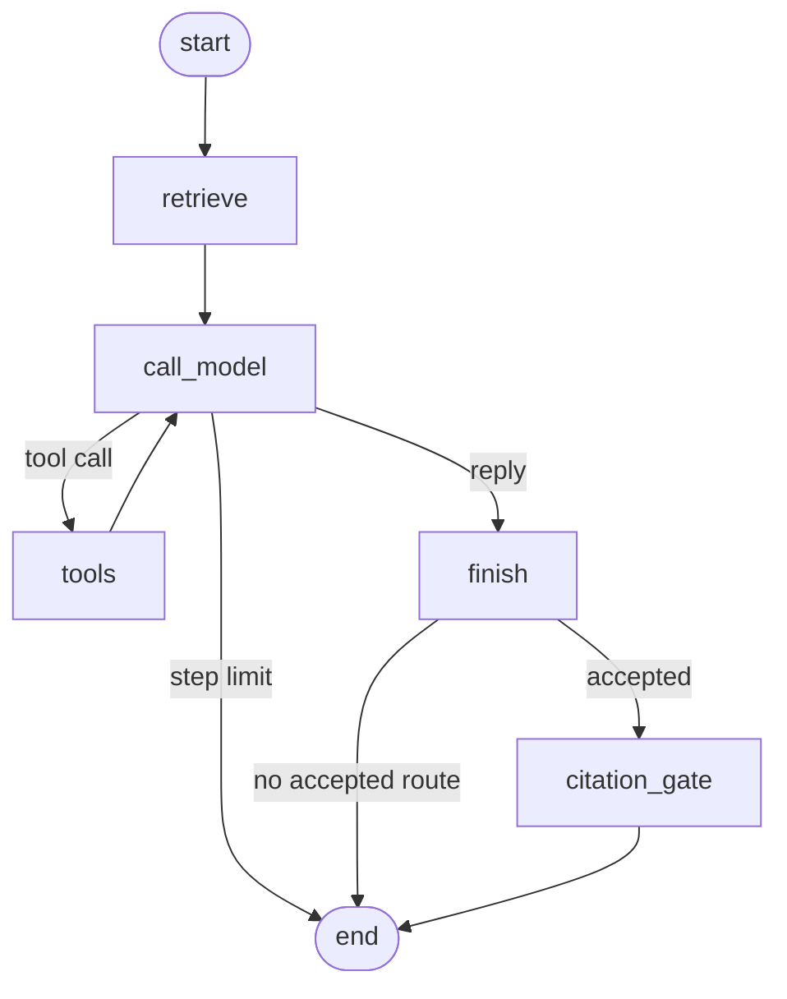

# Support Triage

A customer-support triage agent. It retrieves a checked-in help center, then routes the ticket.

This repository started from the [LangGraph react-agent template](https://github.com/langchain-ai/react-agent) (MIT, Copyright 2024 LangChain). The graph is that tool loop, renamed to `support_triage`, with the template web-search tool removed. [ADR-001](docs/adr/ADR-001-langgraph-react-agent.md) records why the loop is the starting point, and how a Deep Agent can replace that graph or wrap it later.

Acceptance criteria are on [issue 1](https://github.com/gabezurita/support-triage/issues/1).

## Quickstart

Python 3.12. From the repository root:

```bash
uv sync
cp .env.example .env
uv run langgraph dev
```

Set `SUPPORT_TRIAGE_PROVIDER` to `gemini`, `anthropic`, or `codex`. The default is `gemini`. Gemini reads `GEMINI_API_KEY` or `GOOGLE_API_KEY`. Anthropic reads `ANTHROPIC_API_KEY`. Codex reads `OPENAI_API_KEY` and calls `gpt-5.3-codex`. `.env.example` also names `LANGSMITH_API_KEY` and `LANGSMITH_PROJECT`. The unit tests, the trajectory checks, and the dataset evaluation do not call a provider.

Run the offline suite with:

```bash
uv run pytest
```

The Studio walkthrough is [docs/demo.md](docs/demo.md). It covers the tunnel Chrome needs, the four tickets, and where the citation-gate rejection is recorded.

## Graph

Retrieval runs before the model. The model may call `lookup_order` and `route_ticket`. The citation gate rejects a reply that cites an article the retrieval step did not return. On a step limit, that same decision runs inside the model node so the run can still stop.



`start` is the new ticket. `retrieve` searches the checked-in help center and writes the matching articles onto `passages` before the model runs. `call_model` reads those passages and may call `lookup_order` and `route_ticket`. `tools` runs the calls from that step and returns to `call_model`. `finish` records whether `route_ticket` was accepted. `citation_gate` accepts the reply when the ids passed to `route_ticket` are among the retrieved articles and the reply cites that same set. `end` is the stop.

The arrow labels are the choices between those boxes. `tool call` means the model asked for `lookup_order` or `route_ticket`, so the run goes to `tools` and then back to `call_model`. `reply` means the model stopped calling tools, so the run goes to `finish`. `accepted` means `route_ticket` recorded a queue, so the run goes through `citation_gate` before `end`. `no accepted route` means the model skipped `route_ticket` or the queue was rejected. A skipped call still records `human` with no citation ids, sets `accepted` false, and fails the trajectory check. A rejected queue records nothing. Either way the run goes to `end` and skips the gate. `step limit` means too few steps remain for another node, so `call_model` applies that same `finish` and `citation_gate` decision itself and the arrow goes to `end`.

## Traces

When `LANGSMITH_API_KEY` is set, `uv run langgraph dev` sends traces to the LangSmith project named by `LANGSMITH_PROJECT`. The example project name is `support-triage`. Open that project in LangSmith to see the run.

The checked-in redacted trace is [data/evaluation/traces/billing-double-charge.json](data/evaluation/traces/billing-double-charge.json). The live judge result is [data/evaluation/live_judge.json](data/evaluation/live_judge.json). The offline record is [EVAL-001](docs/evaluations/EVAL-001-citation-gate.md). The dataset, the human labels, and the fixture judge are in `data/evaluation/`.
